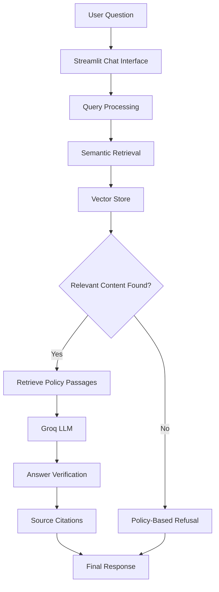

# 🏦 Aurora Bank – AI-Powered Banking FAQ Assistant

<p align="center">
  <b>An Intelligent Banking Assistant Powered by Retrieval-Augmented Generation (RAG)</b>
</p>

<p align="center">
  
  
  
  
  
</p>

## 📌 Project Overview

Aurora Bank FAQ Assistant is an AI-powered conversational chatbot designed to answer banking-related questions using Retrieval-Augmented Generation (RAG).

The application helps users understand banking services, including savings accounts, fixed deposits, personal loans, home loans, credit cards, interest rates, banking charges, and transaction-related policies.

Unlike traditional chatbots, Aurora Bank uses a document-grounded approach. It retrieves relevant information from banking policy documents and generates answers based only on the retrieved content.

The assistant also provides source citations and refuses to answer questions when the required information is unavailable in its knowledge base, helping reduce AI hallucinations.

**Note:** Aurora National Bank is a fictional bank, and its policy documents are sample data created for academic and demonstration purposes.

## 🎯 Project Objectives

- Develop an intelligent banking FAQ chatbot.
- Implement Retrieval-Augmented Generation architecture.
- Provide accurate answers from banking policy documents.
- Reduce AI hallucinations through grounded responses.
- Display supporting document references for answers.
- Support multiple policy documents in a knowledge base.
- Enable document uploads for knowledge-base expansion.
- Maintain conversational context for follow-up questions.

## ✨ Key Features

### 1. 🤖 AI-Powered Banking Chatbot
- Interactive conversational interface.
- Natural-language question answering.
- Streaming AI-generated responses.
- Powered by Groq API.
- Handles banking-related customer queries.

### 2. 📚 Document-Based Knowledge Retrieval
- Supports PDF, TXT, and Markdown documents.
- Automatically extracts and processes policy content.
- Splits documents into topic-focused passages.
- Preserves document, section, and page information.
- Rebuilds the knowledge index when documents change.

### 3. 🧠 Retrieval-Augmented Generation (RAG)
- Generates sentence embeddings using MiniLM.
- Supports TF-IDF fallback when semantic embeddings are unavailable.
- Performs cosine-similarity-based retrieval.
- Retrieves the most relevant policy passages.
- Uses retrieved information as context for AI responses.

### 4. 🛡️ Hallucination Prevention
The application uses four layers of answer verification:

- **Similarity Threshold:** Rejects unrelated questions before calling the AI model.
- **Grounded Prompting:** Restricts generated answers to retrieved policy information.
- **Refusal Handling:** Clearly declines questions that are not covered by available documents.
- **Citation Verification:** Checks source references and supported numerical claims.

### 5. 🔍 Source Citations
- Displays numbered source references.
- Shows supporting policy passages.
- Helps users understand where an answer originated.
- Checks for invalid or missing citations.

### 6. 📂 Knowledge Base Management
- Browse available banking policy documents.
- Upload additional PDF, TXT, and Markdown files.
- Automatically process newly uploaded documents.
- Maintain a persistent vector index.
- Manage policy versions using effective dates and supersession information.

### 7. 💬 Conversation Management
- Interactive chat experience.
- Ready-made questions organized by banking topics.
- Follow-up question support.
- Maintains context across related questions.
- Resolves follow-up references to previously discussed topics.

### 8. 🧪 Testing & Evaluation
- Offline pipeline testing.
- Retrieval and similarity testing.
- Answer verification testing.
- Streaming response testing.
- Live LLM evaluation with recorded results.

## 🛠️ Technology Stack

| Category | Technologies |
|---|---|
| Programming Language | Python |
| Frontend / UI | Streamlit |
| AI Model Provider | Groq API |
| Architecture | Retrieval-Augmented Generation (RAG) |
| Embeddings | FastEmbed / MiniLM |
| Fallback Retrieval | TF-IDF |
| Similarity Search | Cosine Similarity |
| Document Processing | PDF, TXT, Markdown |
| NLP | Sentence Embeddings |
| Environment Management | Python dotenv / Streamlit Secrets |
| Testing | Pytest |
| Version Control | Git & GitHub |
| Deployment | Streamlit Community Cloud |

## 🏗️ System Architecture

The project follows a Retrieval-Augmented Generation workflow.



## 📂 Project Structure

```text
Aurora-Bank-FAQ-Assistant/
│
├── .streamlit/
│   └── config.toml
│
├── assets/
│   └── style.css
│
├── data/
│   ├── policies/
│   └── uploads/
│
├── rag/
│   ├── config.py
│   ├── ingest.py
│   ├── embedder.py
│   ├── vectorstore.py
│   ├── retriever.py
│   ├── generator.py
│   ├── verification.py
│   └── pipeline.py
│
├── scripts/
│   ├── ask.py
│   └── evaluate_live.py
│
├── tests/
│   └── evaluations/
│
├── app.py
├── requirements.txt
├── .env.example
├── .gitignore
└── README.md
```

## ⚙️ Installation & Setup

### Prerequisites

- Python 3.10 or above
- Visual Studio Code
- Git
- Groq API Key

### Step 1: Clone the Repository

```bash
git clone https://github.com/lokeshwar5221/Aurora-Bank-FAQ-Assistant.git
```

### Step 2: Navigate to the Project

```bash
cd Aurora-Bank-FAQ-Assistant
```

### Step 3: Create a Virtual Environment

```bash
python -m venv .venv
```

Activate the environment.

**Windows:**

```bash
.venv\Scripts\activate
```

**Mac/Linux:**

```bash
source .venv/bin/activate
```

### Step 4: Install Dependencies

```bash
python -m pip install -r requirements.txt
```

### Step 5: Configure Groq API Key

1. Visit https://console.groq.com/keys
2. Sign in to your Groq account.
3. Generate an API key.
4. Create a `.env` file in the project root.
5. Add your API key:

```env
GROQ_API_KEY=your_groq_api_key
```

Never upload your API key or `.env` file to GitHub.

### Step 6: Run the Application

```bash
streamlit run app.py
```

Open the application in your browser:

```text
http://localhost:8501
```

## ☁️ Deployment

The application can be deployed using **Streamlit Community Cloud**.

1. Push your project to GitHub.
2. Visit https://share.streamlit.io/
3. Sign in using GitHub.
4. Select your Aurora Bank FAQ Assistant repository.
5. Select `app.py` as the main application file.
6. Open Advanced Settings → Secrets.
7. Add your Groq API key:

```toml
GROQ_API_KEY = "your_groq_api_key"
```

8. Deploy the application.

## 💡 Sample Questions

Try asking the chatbot:

**Savings Accounts**
- What is the minimum balance for a regular savings account?
- What are the benefits of a savings account?

**Fixed Deposits**
- What are the FD interest rates for senior citizens?
- What is the minimum deposit period?

**Loans**
- What are the eligibility criteria for a personal loan?
- What is the home loan processing fee?

**Credit Cards**
- What is the late payment fee on credit cards?
- What are the applicable credit card charges?

**Banking Security**
- How do I report a fraudulent transaction?

**Out-of-Scope Questions**
- Who won the Cricket World Cup?
- Can I buy Bitcoin through the bank?

The chatbot should decline questions that are not covered by the banking policy documents.

## 🧪 Running Tests

Run the offline test suite:

```bash
python -m pytest -q
```

You can also run:

```bash
python tests/test_pipeline.py
```

To execute the live Groq evaluation:

```bash
python scripts/evaluate_live.py --confirm-live
```

This requires a configured API key and may consume API quota.

## 🔮 Future Enhancements

- Multilingual banking assistance (English, Telugu, Hindi).
- EMI and loan eligibility calculator.
- Voice-based banking assistant.
- Advanced hybrid search using keyword and semantic retrieval.
- Improved document re-ranking.
- Chat feedback and response ratings.
- Additional banking services and policy integrations.
- Enhanced analytics dashboard.

## 🎓 Project Information

**Project Name:** Aurora Bank – AI-Powered Banking FAQ Assistant

**Project Domain:** Artificial Intelligence | Generative AI | Natural Language Processing

**Project Type:** Python Full Stack / Generative AI Project

**Core Concept:** Retrieval-Augmented Generation (RAG)

## 👨‍💻 Developer

**GitHub:** [lokeshwar5221](https://github.com/lokeshwar5221)

**Project Repository:** [Aurora Bank FAQ Assistant](https://github.com/lokeshwar5221/Aurora-Bank-FAQ-Assistant)

---

## ⭐ Support

If you find this project useful or interesting, please consider giving the repository a ⭐ on GitHub.

<p align="center">
  <b>Making Banking Information Easier to Understand with AI! 🏦🤖</b>
</p>
